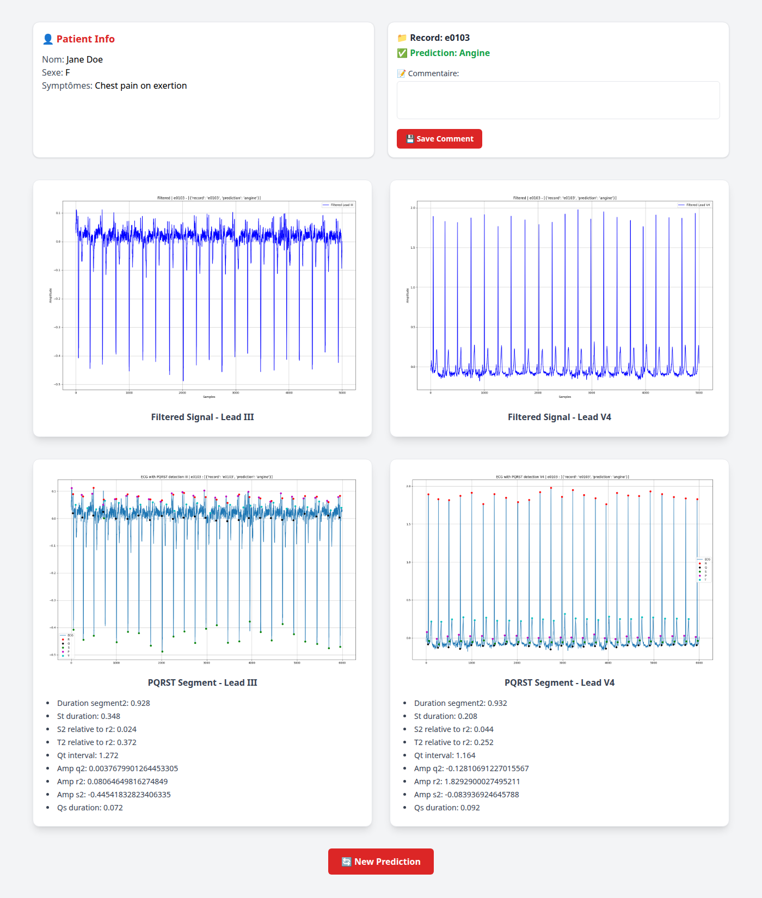
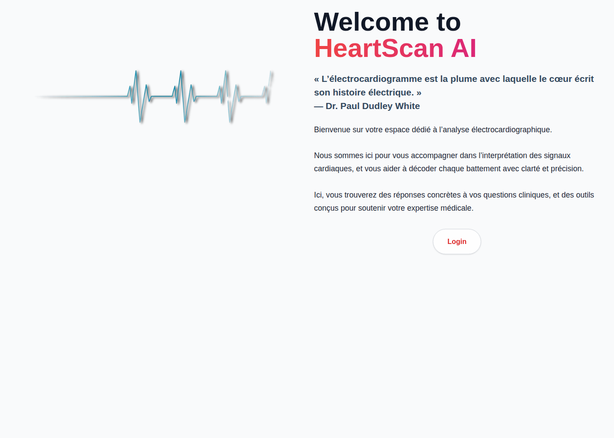
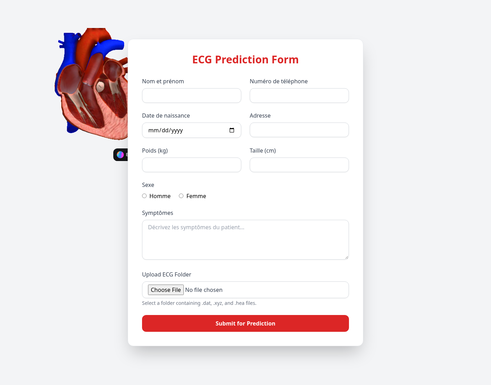

# HeartScan AI — ECG Ischemia Prediction

> Classifies a 2-lead ECG recording as **healthy**, **angina** or **myocardial infarction** using signal processing, handcrafted entropy features and an SVM, served through a Flask web app.


<p align="center">
  
</p>

## Overview

Myocardial ischemia leaves subtle traces in the ECG — mostly in the ST segment and T wave. This project builds the full
pipeline from raw PhysioNet recordings to a web application a clinician could use:

1. **Filter** the raw signal (baseline wander, power-line noise, high-frequency noise).
2. **Detect** heartbeats with the Pan-Tompkins algorithm and locate P, Q, R, S and T waves.
3. **Extract** 10 statistical and non-linear (entropy) features per beat on two leads — **V4** and **III**.
4. **Classify** every beat with an SVM and take a **majority vote** to label the whole recording.

## Features

- 🩺 **Web app** — login, patient form, upload of a WFDB record (`.dat` + `.hea` + `.xyz`/`.atr`).
- 📈 **Visual report** — filtered leads III and V4, P/Q/R/S/T detection, QT/ST intervals and QRS amplitudes.
- 🧠 **3-class prediction** — `Sain` (healthy), `angine` (angina), `infactus` (infarction).
- 🔬 **Reproducible research** — five notebooks covering the whole training pipeline.
- ✅ **Tested** — unit tests for the signal processing and end-to-end tests that check the refactored code reproduces the original outputs exactly.

## Screenshots

| Home | Patient form |
|---|---|
|  |  |

> The user interface is in French.

## How it works

```
 raw ECG (V4, III)
        │
        ▼
 Filtering ── 0.5 Hz high-pass → 50 Hz notch → 100 Hz low-pass (Butterworth order 4, zero-phase)
        │
        ▼
 Pan-Tompkins on V4 ── derivative → squaring → 150 ms moving window → R-peaks
        │
        ▼
 Beat segments ── R-R intervals over the first 60 s
        │
        ▼
 Features (per segment, per lead) ── max, min, mean, std, RMS, kurtosis, skewness,
        │                             sample entropy, permutation entropy, approximate entropy
        ▼
 SVM (RBF, C = 60, γ = 0.01) ── one prediction per beat
        │
        ▼
 Majority vote ── Sain · angine · infactus
```

### Data

| Class | Source | Records |
|---|---|---|
| 0 · Sain (healthy) | [PTB Diagnostic ECG Database](https://physionet.org/content/ptbdb/1.0.0/) — healthy controls | 80 |
| 1 · angine (angina) | [European ST-T Database](https://physionet.org/content/edb/1.0.0/) | 20 |
| 2 · infactus (infarction) | [European ST-T Database](https://physionet.org/content/edb/1.0.0/) | 11 |

### Results

Segment-level evaluation on a 70/30 split after class balancing (6,170 segments per class) — see [`notebooks/05_classification.ipynb`](notebooks/05_classification.ipynb):

| Class | Precision | Recall | F1-score |
|---|---|---|---|
| Sain | 1.00 | 1.00 | 1.00 |
| angine | 0.98 | 0.99 | 0.98 |
| infactus | 0.99 | 0.98 | 0.98 |
| **Accuracy** | | | **98.8 %** |

> ⚠️ **Caveat:** the split is made at the beat level, so beats from the same patient appear in both the training and
> test sets. This score therefore measures how well the model recognises *known* patients; a patient-wise split
> (e.g. `GroupKFold`) is needed to estimate performance on new patients. See the [roadmap](#roadmap--known-limitations).

## Getting started

### Prerequisites

- Python **3.12**
- `git`
- ~1 GB of free disk space for the virtual environment (raw datasets only needed to retrain)

### Installation

```bash
git clone https://github.com/IhebKhalfallaah/ECG-Signal-Prediction-.git
cd ECG-Signal-Prediction-

python3 -m venv .venv
source .venv/bin/activate        # Windows: .venv\Scripts\activate
pip install -r requirements.txt
```

### Run the web app

```bash
python run.py
```

Open http://127.0.0.1:5000, click **Login** and sign in with the demo credentials `admin` / `1234`.

Credentials can be changed with environment variables:

| Variable | Default | Purpose |
|---|---|---|
| `ECG_USERNAME` | `admin` | Login username |
| `ECG_PASSWORD` | `1234` | Login password |
| `SECRET_KEY` | `your_secret_key` | Flask secret key — set your own outside local demos |
| `FLASK_DEBUG` | unset | Set to `1` to enable Flask debug mode |

### Try it with the sample record

On the prediction form, select the three files from [`data/sample/`](data/sample) —
`e0103.dat`, `e0103.hea`, `e0103.atr` — and submit. Expected result: **Prediction: Angine**, with four plots and the
interval metrics for leads III and V4.

### Use the pipeline from Python

```python
from ecg.predict import predict_majority_class_from_file
from ecg.features import extract_features_from_ecg

features = extract_features_from_ecg("data/sample/e0103")      # one row per beat segment
print(features.shape)                                           # (58, 21)

label = predict_majority_class_from_file("data/sample/e0103", "models/svm_model_C60_gamma001.pkl")
print(label)                                                    # angine
```

### Run the tests

```bash
pip install -r requirements-dev.txt
pytest
```

## Training pipeline (notebooks)

The notebooks were run on Google Colab (some cells use CuPy on a GPU); their outputs are saved so they can be read
directly on GitHub. To rerun them, download the datasets as described in [`data/README.md`](data/README.md).

| # | Notebook | What it does |
|---|---|---|
| 01 | [`01_dataset_and_labels`](notebooks/01_dataset_and_labels.ipynb) | Unzips both databases into `Normal/` and `Ischemic/` — the binary label source |
| 02 | [`02_signal_filtering`](notebooks/02_signal_filtering.ipynb) | Filter design, spectra, Pan-Tompkins and PQRST detection on leads III and V4 |
| 03 | [`03_features_lead_iii`](notebooks/03_features_lead_iii.ipynb) | Per-segment features on lead III → `fd3.csv` |
| 04 | [`04_features_lead_v4`](notebooks/04_features_lead_v4.ipynb) | Per-segment features on lead V4 → `fV4.csv` |
| 05 | [`05_classification`](notebooks/05_classification.ipynb) | Merge leads, 3-class labels, SVM vs. KNN grid search, final model export |

## Project structure

```
ECG-Signal-Prediction/
├── app/                      # Flask web application
│   ├── __init__.py           #   create_app() factory
│   ├── config.py             #   settings and environment variables
│   ├── routes.py             #   pages: home, login, form, prediction
│   ├── templates/            #   Jinja2 templates (Tailwind CSS)
│   └── static/images/
├── ecg/                      # Signal-processing and ML core (framework-independent)
│   ├── filters.py            #   high-pass / notch / low-pass filtering
│   ├── detection.py          #   Pan-Tompkins, PQRST detection, interval metrics
│   ├── entropy.py            #   sample, permutation and approximate entropy
│   ├── features.py           #   per-beat feature extraction
│   ├── predict.py            #   SVM inference + majority vote
│   └── plotting.py           #   diagnostic plots for the report page
├── models/                   # Trained SVM (scikit-learn 1.6.1)
├── notebooks/                # Training pipeline, 01 → 05
├── data/                     # labels.csv, sample record, dataset instructions
├── tests/                    # pytest suite + golden fixtures
├── docs/screenshots/
├── run.py                    # Development server entry point
├── requirements.txt
└── requirements-dev.txt
```

## Roadmap / known limitations

- **Patient-wise evaluation** — re-evaluate with a split by patient to get a realistic generalisation estimate.
- **Access control** — the login page is a demo: `/predictPage` and `/Predict` are reachable without signing in, and credentials are a single shared account.
- **Error feedback** — upload errors (missing file, several records) re-display the form without showing the message.
- **Concurrency** — uploads share one folder that is cleared on every prediction; not suitable for multiple simultaneous users.
- **Labels** — class names are displayed in French (`Sain`, `angine`, `infactus`).
- **Filter order** — the exploration notebook (02) uses Butterworth order 5, while the features and the app use order 4.
- **Inputs** — only records containing both a V4 and a III/MLIII lead can be analysed; other records return an error result.

This is a research prototype and **not a medical device**; it must not be used for clinical decisions.

## Contributing

Contributions are welcome — see [CONTRIBUTING.md](CONTRIBUTING.md).

## License

Released under the [MIT License](LICENSE). The PTB and European ST-T databases are distributed by
[PhysioNet](https://physionet.org/) under their own terms; please cite them if you use this work
(references in [`data/README.md`](data/README.md)).

## Author

**Iheb Khalfallah** — [@IhebKhalfallaah](https://github.com/IhebKhalfallaah)
